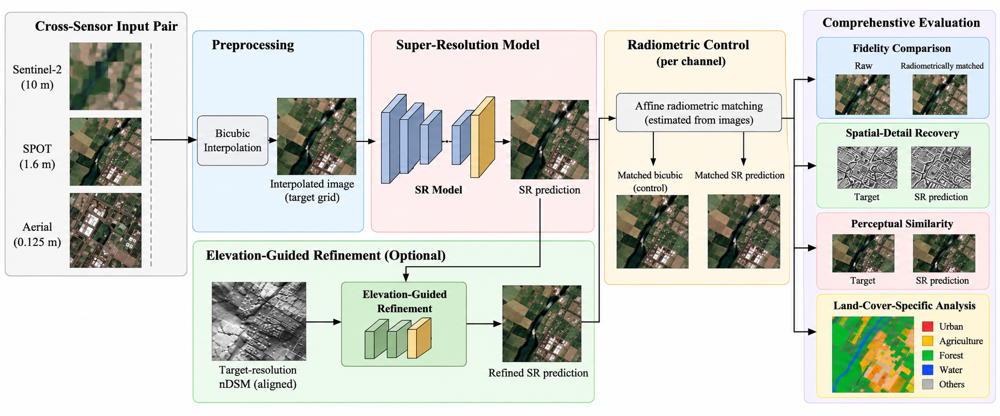
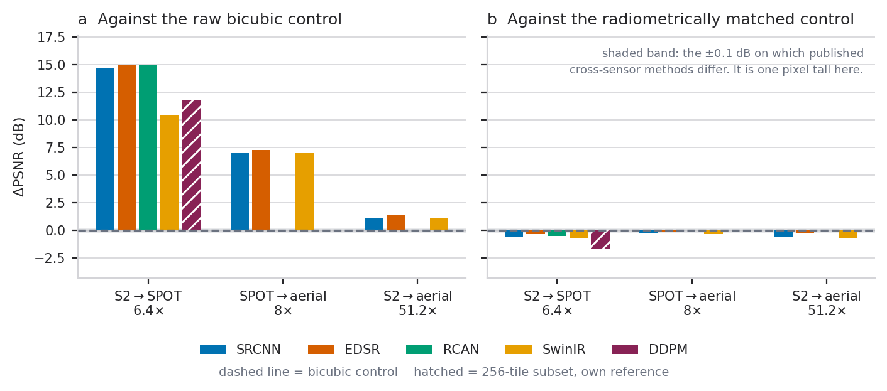
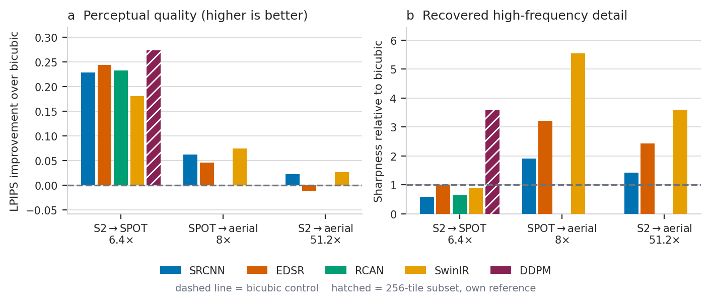
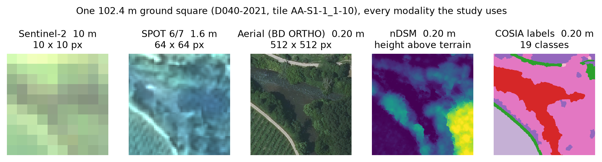
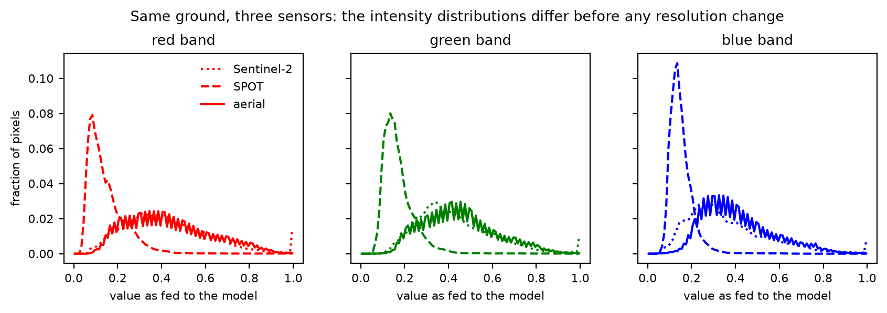

<div align="center">

# Radiometry-Aware Evaluation of Cross-Sensor Satellite Image Super-Resolution

**Most of the PSNR gain that super-resolution reports on real Sentinel-2 → SPOT → aerial pairs is radiometric correction, not recovered detail. This repository has the evaluation, the models, the weights and every script behind the TIME-E 2026 paper.**



[-1E3A5F)](paper/conf.pdf)
[-F9D371)](https://huggingface.co/FatimahEmadEldin/flair-sr-512-runs)
[-F9D371)](https://huggingface.co/datasets/FatimahEmadEldin/flair-guided-sr-512)
[](https://huggingface.co/datasets/IGNF/FLAIR-HUB)
[](LICENSE)

</div>

---

## The problem

Super-resolution (SR) is usually trained and scored on *synthetic* pairs: a high-resolution image and a bicubic-downsampled copy of itself. The two differ only in resolution, so beating bicubic interpolation means recovering detail.

Real cross-sensor pairs are different. Sentinel-2, SPOT and aerial cameras see the same ground with different spectral responses, gains and acquisition dates. A network trained to map one sensor onto another learns to correct that radiometric gap. Bicubic interpolation cannot correct it, because it never changes a pixel's value distribution. A raw ΔPSNR against bicubic therefore mixes two things: radiometric adaptation and spatial-detail recovery.

We separate them with a **symmetric, evaluation-only radiometric control**. A per-image, per-channel least-squares gain and offset is fitted to the target, separately for the SR output and for bicubic. The fit can rescale intensities but cannot add spatial structure, so whatever advantage survives it is spatial. It uses the target, so it is an oracle control for scoring and is never used in training or inference.

## Results

Every number below is read from [`results/results.json`](results/results.json), which [`rebuild_results.py`](scripts/figures/rebuild_results.py) regenerates exactly from the run logs on the Hub. Test set: 1,332 tiles from held-out domains D040 and D044. ± is the sample standard deviation over five seeds (7, 41, 913, 1337, 2026).

### 1. The raw PSNR gain is almost entirely radiometric

| Regime | Scale | Raw ΔPSNR vs bicubic | Bicubic PSNR: raw → matched |
|---|---|---|---|
| Sentinel-2 → SPOT | 6.4× | **+14.70 to +15.01 dB** (SRCNN, EDSR, RCAN) | 14.25 → **35.24 dB** |
| SPOT → aerial | 8× | +6.98 to +7.29 dB | 10.63 → 21.74 dB |
| Sentinel-2 → aerial | 51.2× | +1.09 to +1.36 dB | 16.44 → 21.58 dB |

After matching, every model sits at or slightly below the matched bicubic control. For example, Sentinel-2 → SPOT EDSR goes from 29.26 dB raw to 34.93 dB matched, against 35.24 dB for matched bicubic.



### 2. The models still recover real detail

Sharpness *S* is the mean absolute image gradient relative to bicubic. On SPOT → aerial, EDSR reaches **3.22 ± 0.27×** and SwinIR **5.55×** (single seed). Bicubic carries only about 5% of the target's gradient, so 5.55× is still only about a quarter of it. Per land-cover class, the models recover roughly **13–22%** of the target gradient on structured classes. These per-class figures come from 300 tiles and have no seed uncertainty, so treat them as indicative.



### 3. Elevation guidance helps, but only in a focused case

A target-resolution nDSM refinement head (11,299 parameters, ≈1.2% of EDSR) was tested on SPOT → aerial with EDSR and SRCNN, as paired runs over five seeds ([`results/tab_guided.tex`](results/tab_guided.tex)):

| Model | Matched ΔPSNR | Sharpness | LPIPS ↓ |
|---|---|---|---|
| EDSR | −0.178 ± 0.099 dB | 3.08 ± 0.07× | 0.870 |
| EDSR + nDSM | **+0.022 ± 0.054 dB** | **3.75 ± 0.33×** | **0.782** |
| SRCNN | −0.183 ± 0.126 dB | 1.91 ± 0.36× | 0.852 |
| SRCNN + nDSM | −0.041 ± 0.073 dB | 2.50 ± 0.19× | 0.797 |

With guidance, matched fidelity reaches approximate parity with the control rather than beating it. Detail recovery improves in seven of the eight evaluated classes; plowed land gets worse.

## Scope

- One dataset (FLAIR-HUB, France) and RGB bands only.
- No validation split; every model was trained for a fixed 25 epochs.
- DDPM, S2 → aerial and the SPOT → aerial SwinIR are single runs.
- One SwinIR seed diverged on Sentinel-2 → SPOT, which pulls its mean down.
- The affine control cannot model nonlinear or spatially varying radiometry.

The paper's §III and §V discuss these limits.

## Dataset: what we used from FLAIR-HUB

[FLAIR-HUB](https://huggingface.co/datasets/IGNF/FLAIR-HUB) (IGN, France) co-registers several sensors over the same ground squares in French *départements* ("domains"). We repacked **nine domains** into Parquet ([`flair-guided-sr-512`](https://huggingface.co/datasets/FatimahEmadEldin/flair-guided-sr-512), 24,475 tiles). The paper trains and tests on a fixed **5,994-tile subset** of that pack: the first 666 tiles of each domain that have both Sentinel-2 and SPOT. The test domains are held out geographically and never seen in training.

The exact subset is listed tile by tile in **[`subset/tiles.csv`](subset/tiles.csv)** (split, domain, sector, tile id, row in shard). [`make_subset.py`](scripts/data/make_subset.py) regenerates it with the same rule the training code applies, and asserts the 4,662 / 1,332 split.

**Sensors and resolution.** Every tile is the same 102.4 m × 102.4 m ground square (≈1.05 ha):

| Modality | Ground sampling | Tile size | Bands used | Role |
|---|---|---|---|---|
| Sentinel-2 (time series) | 10 m | 10 × 10 px | B4, B3, B2 (median of 12 temporal bins) | low-resolution input |
| SPOT 6/7 | 1.6 m | 64 × 64 px | R, G, B | input (SPOT → aerial) and target (S2 → SPOT) |
| Aerial orthophoto | 0.20 m | 512 × 512 px | R, G, B | high-resolution target |
| nDSM (DSM − DTM) | 0.20 m | 512 × 512 px | object height | guidance, case study only |
| COSIA land cover | 0.20 m | 512 × 512 px | 19 classes | per-class analysis only |

This gives the paper's three regimes: **S2 → SPOT 6.4×**, **SPOT → aerial 8×** and **S2 → aerial 51.2×**. The pack also carries the aerial near-infrared band, Sentinel-1 and the DTM; the paper does not use them.

**Domains in the subset:**

| Domain | Département (region) | Split | Tiles | Sectors | Mean nDSM height | Pixels > 2 m |
|---|---|---|---|---|---|---|
| D004-2021 | Alpes-de-Haute-Provence (Provence-Alpes-Côte d'Azur) | train | 666 | 7 | 3.44 m | 43% |
| D006-2020 | Alpes-Maritimes (Provence-Alpes-Côte d'Azur) | train | 666 | 7 | 4.88 m | 60% |
| D011-2021 | Aude (Occitanie) | train | 666 | 9 | 1.57 m | 16% |
| D017-2021 | Charente-Maritime (Nouvelle-Aquitaine) | train | 666 | 8 | 2.73 m | 24% |
| D022-2021 | Côtes-d'Armor (Brittany) | train | 666 | 5 | 4.12 m | 38% |
| D033-2021 | Gironde (Nouvelle-Aquitaine) | train | 666 | 8 | 1.72 m | 14% |
| D037-2021 | Indre-et-Loire (Centre-Val de Loire) | train | 666 | 9 | 1.38 m | 15% |
| **D040-2021** | Landes (Nouvelle-Aquitaine) | **test** | 666 | 9 | 2.08 m | 23% |
| **D044-2022** | Loire-Atlantique (Pays de la Loire) | **test** | 666 | 9 | 2.85 m | 31% |
| **Total** | | 4,662 train / 1,332 test | **5,994** | 71 | | |

That is about **62.9 km²** of ground at 0.20 m. The year in each domain name is the acquisition year of the aerial campaign.



**Land cover.** The subset is mostly agricultural and wooded:
- Train pixels: agricultural land 21.8%, deciduous 19.3%, vineyard 17.3%, herbaceous 13.4%.
- Test pixels: agricultural land 38.8%, deciduous 15.0%, herbaceous 9.6%, plowed land 9.5%.

Built classes are small: buildings are about 1% of pixels. The test domains have more plowed land and greenhouses and fewer vineyards than the training domains.

**The radiometric gap, before any resolution change.** In the units the models are trained on, the mean red/green/blue values are:

| Sensor | R | G | B |
|---|---|---|---|
| SPOT | 0.15 | 0.17 | 0.15 |
| Aerial | 0.43 | 0.45 | 0.41 |
| Sentinel-2 | 0.42 | 0.43 | 0.36 |

A network that maps SPOT onto the aerial target must first learn this shift, and bicubic interpolation never can. That is why the paper scores against a radiometrically matched control.



`subset/` also holds the class-share figure ([`fig_classes.png`](subset/eda/fig_classes.png)), all statistics as JSON ([`eda_stats.json`](subset/eda/eda_stats.json)), and one sample tile per domain in [`subset/samples/`](subset/samples/): aerial JPEG, COSIA labels, nDSM in centimetres, and raw SPOT and Sentinel-2 arrays.

## How it works

```
FLAIR-HUB (IGNF) ──► scripts/data ──► Parquet pack on the Hub ──► modal_app (train + evaluate on GPU)
   S2 · SPOT · aerial    download, pair,      flair-guided-sr-512         │  checkpoints + per-epoch logs
   + DEM/DSM (nDSM)      pack, validate                                   ▼
                                                              flair-sr-512-runs (Hub)
                                                                          │
                       results/ · paper figures ◄── scripts/figures ◄─────┘  (logs)
                       per-class analysis       ◄── scripts/eval    ◄────────  (checkpoints + pack)
```

**Models.** SRCNN, EDSR, RCAN, SwinIR and a conditional DDPM (T = 200). The CNN and transformer models predict a residual over bicubic. They are defined once in [`modal_app/flair_sr_core.py`](modal_app/flair_sr_core.py), which is kept byte-identical to the notebook that produced the first runs, so that numbers stay comparable. The nDSM head is a wrapper in [`flair_sr_guided.py`](modal_app/flair_sr_guided.py) and never edits the base model.

**Training.**
- Loss: L1 (DDPM uses noise MSE).
- Optimiser: AdamW at a constant 2e-4.
- Batch: effective 32, held fixed by gradient accumulation on small GPUs.
- Schedule: 25 epochs, with the same 4,662 training tiles for every model.
- Each sensor pair is retrained from scratch.

**Evaluation.**
- PSNR on [0, 1] data, raw and matched.
- LPIPS with AlexNet.
- Gradient *G* as the mean absolute forward difference, and sharpness *S* = *G*(SR) / *G*(bicubic).

## Repository layout

```
modal_app/                Modal app: models, metrics, training, evaluation
  flair_sr_core.py        architectures, PSNR/LPIPS/sharpness, match_radiometry (do not edit)
  flair_sr_guided.py      nDSM-guided refinement head, wrapped around the base model
  flair_sr_modal.py       prepare / main / sweep / push_results entrypoints
  smoke.py                one cheap call that checks GPU, secret, volume and Hub access
scripts/
  data/                   FLAIR-HUB download, Parquet packing, nDSM rebuild, pack validation + upload,
                          make_subset.py (the paper's tiles) and eda_subset.py
  train/watch_runs.py     follow Modal runs from their Hub logs
  hub/download_weights.py pull checkpoints and logs (filter by sweep, regime, arch, seed)
  eval/                   super_resolve.py (one tile, one checkpoint), make_perclass_analysis.py
  figures/                rebuild_results.py, paper figures and tables from the logs
subset/                   the paper's exact 5,994-tile subset: tiles.csv, EDA statistics and figures, samples
results/                  results.json, perclass.json, LaTeX tables, as used in the paper
paper/                    camera-ready LaTeX source, bibliography, figures and the compiled PDF
docs/                     README figures, REVISION_NOTES.md (reviewer comment → change)
tests/                    test_match_radiometry.py: the control removes radiometry, not blur
```

## Weights and data

| Hub repo | Content | Access |
|---|---|---|
| [`FatimahEmadEldin/flair-sr-512-runs`](https://huggingface.co/FatimahEmadEldin/flair-sr-512-runs) | 51 checkpoints and their per-epoch logs, in three sweeps: `v2_512/` (every architecture, seed 1337), `v2_seeds/` (five seeds), `v3_guided/` (nDSM-guided, five seeds) | Private, on request |
| [`FatimahEmadEldin/flair-guided-sr-512`](https://huggingface.co/datasets/FatimahEmadEldin/flair-guided-sr-512) | The training pack: nine FLAIR-HUB domains as Parquet shards with aerial imagery, SPOT, Sentinel-2 and Sentinel-1 time series, COSIA labels, DTM and nDSM | Private, on request |
| [`IGNF/FLAIR-HUB`](https://huggingface.co/datasets/IGNF/FLAIR-HUB) | The source imagery | Public, Etalab Open Licence 2.0 |

The weights and the derived pack are kept private and shared for research on request. To get access, open an issue or ask on the Hub repo page. Once you have it, run `hf auth login` (or set `HF_TOKEN` in `.env`).

```bash
python scripts/hub/download_weights.py --list                       # what is there
python scripts/hub/download_weights.py --run v2_seeds --regime spot_to_aerial --arch edsr
python scripts/hub/download_weights.py --logs-only                  # logs only, a few MB
```

Checkpoints are named `<arch>[_s<seed>]__<regime>_last.pt`; seed 1337 has no suffix.

## Reproducing

```bash
pip install -r requirements.txt
```

**Results, tables and figures from the logs** (CPU, about a minute):

```bash
python scripts/figures/rebuild_results.py           # checks results.json and tab_guided.tex against results/
python scripts/figures/regen_paper_figs.py --out paper/
python tests/test_match_radiometry.py
```

**Super-resolve a tile with a released checkpoint:**

```bash
python scripts/eval/super_resolve.py --arch edsr \
  --ckpt weights/v2_seeds/spot_to_aerial/checkpoints/edsr__spot_to_aerial_last.pt \
  --input spot_tile.npy --target aerial_tile.png --out out/
```

**Data pack from FLAIR-HUB:**

```bash
python scripts/data/flair_download.py --root data/flair-data
python scripts/data/make_parquet_pack_v2.py --root data/flair-data --out data/flair-parquet-v2
python scripts/data/rebuild_with_dsm.py --src data/flair-data --out data/flair-parquet-v3 --repo <you>/flair-guided-sr-512
```

**The paper's subset and its EDA** (from the full pack, about 3 minutes on CPU):

```bash
python scripts/data/make_subset.py --pack data/flair-parquet-v3 --export data/flair-sr-subset   # 2.4 GB, the 5,994 tiles only
python scripts/data/eda_subset.py  --pack data/flair-parquet-v3
```

**Training on Modal.** The scripts expect a Modal secret named `huggingface` that holds `HF_TOKEN`. Set `PACK_REPO` and `OUT_REPO` at the top of `flair_sr_modal.py` to your own repos.

```bash
modal run modal_app/smoke.py
modal run modal_app/flair_sr_modal.py::prepare
modal run --detach modal_app/flair_sr_modal.py::sweep --run-id v2_seeds --seeds 1337,2026,7,41,913
modal run --detach modal_app/flair_sr_modal.py::sweep --run-id v3_guided --guided \
  --archs edsr,srcnn --regimes spot_to_aerial --seeds 1337,2026,7,41,913
modal run modal_app/flair_sr_modal.py::main --arch ddpm --regime s2_to_spot
python scripts/train/watch_runs.py --repo <you>/flair-sr-512-runs --follow
```

Sentinel-2 → SPOT runs on a T4. The 512 px aerial regimes default to an H100.

**Per-class analysis and the qualitative figure:**

```bash
python scripts/eval/make_perclass_analysis.py --pack data/flair-parquet-v3 \
  --ckpt-base <edsr ckpt> --ckpt-guided <edsr_guided ckpt> --out results/
python scripts/figures/make_perclass_outputs.py --json results/perclass.json --out paper/
python scripts/figures/make_qualitative_figure.py --pack data/flair-parquet-v3 --ckpt <edsr ckpt> --out paper/
```

**Paper:** `cd paper && pdflatex conf && bibtex conf && pdflatex conf && pdflatex conf`.

## Citation

```bibtex
@inproceedings{alnakhli2026radiometry,
  title     = {Radiometry-Aware Evaluation of Cross-Sensor Satellite Image Super-Resolution},
  author    = {Alnakhli, Mohammad and Emad Eldin, Fatimah and Alsulami, Ahad Majed and
               Alsaidi, Mohsn Alawi and Alharbi, Layan Mohammed},
  booktitle = {Proc. TIME-E 2026},
  year      = {2026}
}
```

## License

The code is under [MIT](LICENSE). FLAIR-HUB imagery is © IGN, under the Etalab Open Licence 2.0. The derived pack and the weights inherit that attribution requirement.
